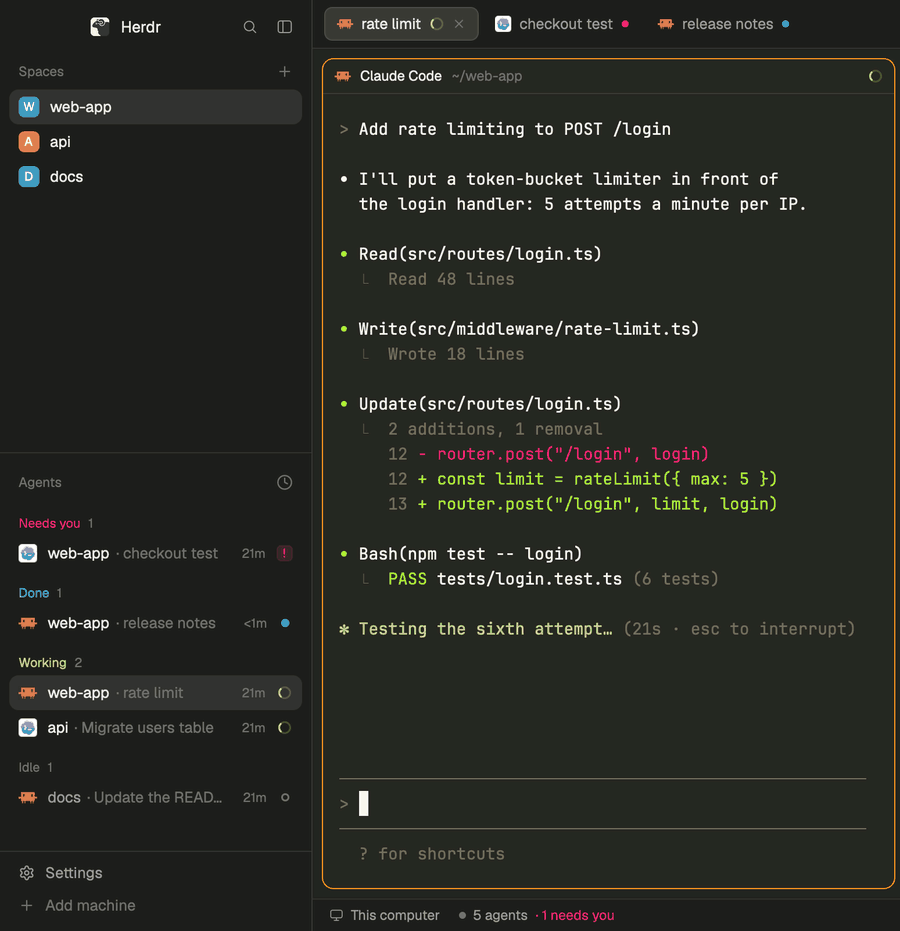

# Monokai

The classic Monokai dark theme from Sublime Text and VS Code, across the whole [Herdr](https://herdr.dev) window: sidebar, tabs and every terminal.


- **Agents in Monokai colors:** yellow while working, pink when they need you, cyan when done.
- **An orange ring** on the pane you're typing in, a color no agent state uses.
- **Bright terminal colors.** VS Code's built-in Monokai dims the colors most programs print. Here they're the vivid ones, so Claude Code and Codex output stays bright.
- **Two themes:** Monokai, and Monokai Dimmed for a quieter grey look. Both work with any layout.
- **Nothing runs.** Just JSON files and a picture: no mods, no code, no network.



It's Herdr's own window, unchanged; only the colors are new. Needs Herdr 0.1.13 or later.

## Install

In Herdr, ask your agent:

```text
Read ~/.config/herdr-app/AGENTS.md, then add this layout: github.com/pedroparra/herdr-monokai
```

Or by hand:

```sh
git clone https://github.com/pedroparra/herdr-monokai
cd herdr-monokai
cp -n layouts/monokai-for-herdr.* ~/.config/herdr-app/layouts/
cp -n themes/*.json ~/.config/herdr-app/themes/
herdr-app do layout.switch --name monokai-for-herdr
```

`cp -n` never overwrites your files, and `ctrl-shift-l` switches back to your other layouts.

If you keep it, a ★ on this repo helps others find it: the Herdr gallery sorts by stars.

### Only the colors

Copy just the `themes/` files and pick **monokai** or **monokai-dimmed** in Settings → Look, in any layout. Both are dark themes, so Herdr uses them in dark mode: if your system is in light mode, add `"appearance": "dark"` to `~/.config/herdr-app/settings.json` and reopen Herdr.

### Update or remove

Switch to another layout with `ctrl-shift-l`, then delete these four files from `~/.config/herdr-app/`. To update, install again.

- `layouts/monokai-for-herdr.json` and `layouts/monokai-for-herdr.svg`
- `themes/monokai.json` and `themes/monokai-dimmed.json`

Your spaces, tabs and terminals aren't touched.

## Credits

- Monokai is by Wimer Hazenberg (2006). This port is not affiliated with or endorsed by Monokai or Monokai Pro.
- The colors follow the Monokai and Monokai Dimmed themes built into [Visual Studio Code](https://github.com/microsoft/vscode) (MIT).
- The layout is Herdr's own `main` ([herdrdev/herdr-app](https://github.com/herdrdev/herdr-app), Apache-2.0).
- The demo follows the approach of [shellscape/herdr-whitby](https://github.com/shellscape/herdr-whitby)'s demo script.

## For contributors

Every color, size and contrast ratio, and how to rebuild the layout from scratch, is in [RECIPE.md](RECIPE.md).

- `scripts/demo.sh` opens a second Herdr window with example projects and stand-in agents. It has its own Herdr home, core and `HOME`, so it can't see or change your spaces or settings, and no real agent runs. `scripts/demo.sh shot` and `scripts/demo.sh gif` save `preview.png` and `states.gif` from it (they need [uv](https://docs.astral.sh/uv/)); `scripts/demo.sh stop` closes it.
- `scripts/sync-main.py` rebuilds the layout from Herdr's own `main.json`. A weekly workflow runs it and opens a PR when Herdr changes its window.

## License

[Apache-2.0](LICENSE), the same license as Herdr. [NOTICE](NOTICE) lists what comes from Herdr, Monokai and VS Code.
