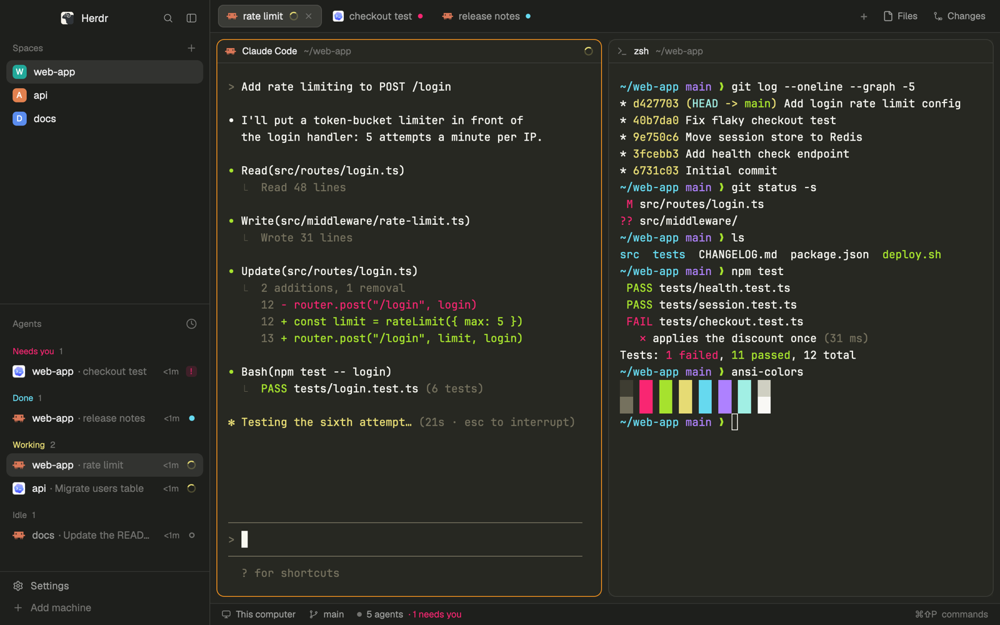

# Monokai for Herdr

The original Monokai colors for the [Herdr](https://herdr.dev) app. Olive-black panels, terminals on `#272822` with Monokai's pink, green, yellow, cyan and purple, and an orange ring on the pane you're typing in. It's Herdr's own window, unchanged: spaces and agents on the left, tabs on top, panes as cards. Only the colors are new.



**No mods, no code.** The layout is two JSON files and a picture. Herdr's own mods draw everything, so there is nothing here that runs, reads your files or reaches the network.

Needs Herdr 0.1.13 or later.

## Install

In Herdr, ask your agent:

```text
Read ~/.config/herdr-app/AGENTS.md, then add this layout: github.com/pedroparra/herdr-monokai
```

Or install it by hand:

```sh
git clone https://github.com/pedroparra/herdr-monokai
cd herdr-monokai
cp -n layouts/monokai-for-herdr.json layouts/monokai-for-herdr.svg ~/.config/herdr-app/layouts/
cp -n themes/monokai.json ~/.config/herdr-app/themes/
herdr-app do layout.switch --name monokai-for-herdr
```

`cp -n` never replaces a file you already have. `ctrl-shift-l` switches back to your other layouts. If your Herdr uses another folder, set `HERDR_APP_HOME` and copy there instead.

### Just the colors

To keep your own layout, copy only `themes/monokai.json` into `~/.config/herdr-app/themes/` and pick `monokai` in Settings → Look. The theme has its own name, different from the layout's, so Herdr offers it in every layout.

### Update or remove

To update, delete the three files below from `~/.config/herdr-app/` and install again. To remove, switch to another layout (`herdr-app do layout.switch --name main`) and delete them:

- `layouts/monokai-for-herdr.json`
- `layouts/monokai-for-herdr.svg`
- `themes/monokai.json`

Your spaces, tabs and terminals live in herdr-core, not in the layout, so nothing else changes.

### Try it without touching your own Herdr

```sh
scripts/demo.sh          # a second Herdr window with this layout and demo content
scripts/demo.sh shot     # save preview.png from it
scripts/demo.sh stop     # quit it and stop its core
```

The demo has its own Herdr home, its own herdr-core session and its own `HOME`, so it can't see or change your spaces, terminals or settings. It opens three example projects with agents in every state. The agents are small scripts that print text and report a status; no real agent runs. The picture above is this demo.

## The colors

| | black | red | green | yellow | blue | magenta | cyan | white |
|---|---|---|---|---|---|---|---|---|
| normal | `#3e3d32` | `#f92672` | `#a6e22e` | `#e6db74` | `#66d9ef` | `#ae81ff` | `#a1efe4` | `#cfcfc2` |
| bright | `#75715e` | `#f92672` | `#a6e22e` | `#e6db74` | `#66d9ef` | `#ae81ff` | `#a1efe4` | `#f9f8f5` |

Terminal text `#f8f8f2` on `#272822`, selection `#49483e`. The sidebar and bars are `#1e1f1c`, as in VS Code's Monokai.

A few choices made for a terminal app with agents:

- **Vivid normal colors.** VS Code's built-in Monokai keeps the normal ANSI colors muted (`#c4265e`, `#86b42b`…) and saves the vivid ones for the bright slots. Most terminal output uses the normal colors, so there it looks grey. Here the normal colors are the vivid Monokai ones.
- **An orange focus ring.** Herdr draws agent states with three terminal colors: working is yellow, needs you is pink, done is cyan. Orange `#fd971f` is the one Monokai color left, so the ring around the focused pane never reads as a state.
- **Contrast, measured.** Text on the background is 13.9:1, the focus ring 6.8:1 and comments (`#75715e`) 3.0:1.

## What's inside

| File | What it is |
|---|---|
| `themes/monokai.json` | the terminal palette, plus the sidebar, background and accent colors |
| `layouts/monokai-for-herdr.json` | Herdr's `main` layout with `"theme": "monokai"` at its root |
| `layouts/monokai-for-herdr.svg` | the picture Herdr's settings show for the layout |
| `RECIPE.md` | how to rebuild it from scratch, with every color and where it goes |
| `preview.png` | the picture for this README and the Herdr gallery |
| `scripts/demo.sh` | the demo window above; `demo-agent.sh` and `demo-shell.sh` fill its panes |

## Credits

- The Monokai color scheme is by Wimer Hazenberg (2006). This port is not affiliated with or endorsed by Monokai or Monokai Pro.
- The terminal, text and sidebar colors follow the Monokai theme built into [Visual Studio Code](https://github.com/microsoft/vscode) (MIT).
- The layout is Herdr's own `main` ([herdrdev/herdr-app](https://github.com/herdrdev/herdr-app), Apache-2.0).
- The isolated demo follows the approach of [shellscape/herdr-whitby](https://github.com/shellscape/herdr-whitby)'s demo script.

## License

[Apache-2.0](LICENSE), the same license as Herdr. [NOTICE](NOTICE) lists what comes from Herdr, Monokai and VS Code.
