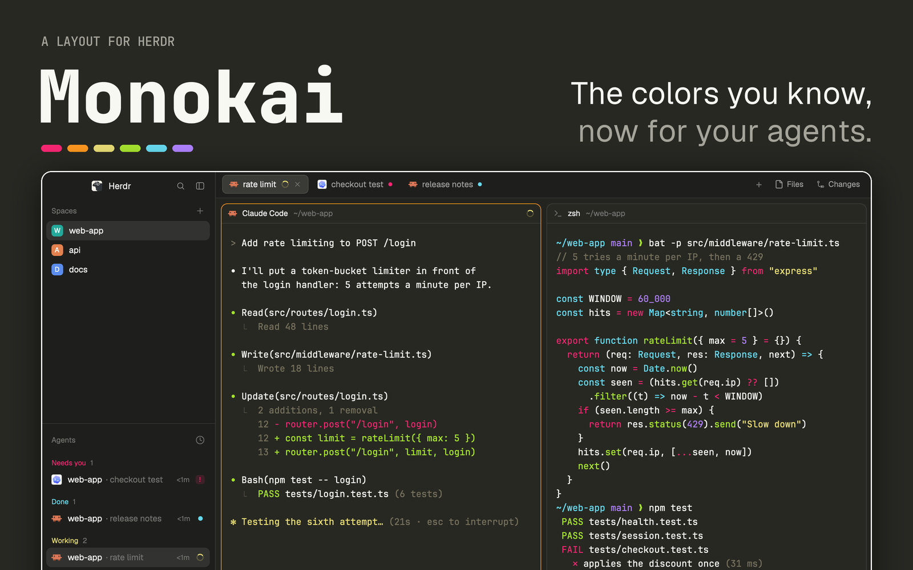

# Monokai

The classic Monokai dark theme from Sublime Text and VS Code, across the whole Herdr window: sidebar, tabs and every terminal. Agents show their state in Monokai's own colors (yellow working, pink needs you, cyan done), and an orange ring marks the pane you're typing in. Vivid ANSI colors keep Claude Code and Codex output bright. Just colors: no mods, no code, nothing runs. Monokai and Monokai Dimmed also show up in Settings → Look, for any layout.

## What you see

Left to right, filling the window (no system title bar; macOS window buttons at 12, 16):

1. **The sidebar**, 268px, `#1e1f1c`. A 46px brand row, the Spaces list and the Agents list sharing the height, then a 69px footer (Settings, Add machine). Selected rows sit on a `#ffffff17` pill. Section titles and secondary text are `#737370`; row text is `#eeeeef`.
2. **The tab bar**, 42px, `#1e1f1c`, with a 1px `#ffffff18` line under it. The active tab is a `#3a3b36` pill with a `#ffffff18` border; the others are `#9e9f9d` text. Files and Changes buttons sit on the right.
3. **The work area**, `#232420`, with 8px padding and 8px gaps. Each pane is a card on `#272822`: 10px radius, 1px `#ffffff18` border, a 30px header with the program, its name and its folder. The focused pane's border is orange, `#fd971f`. The Files/Changes panel (368px, hidden at first) opens on the right.
4. **The status bar**, 28px, `#1e1f1c`.

Terminals: text `#f8f8f2`, selection `#49483e`, cursor `#f8f8f0`. The 16 colors:

| | black | red | green | yellow | blue | magenta | cyan | white |
|---|---|---|---|---|---|---|---|---|
| normal | `#3e3d32` | `#f92672` | `#a6e22e` | `#e6db74` | `#66d9ef` | `#ae81ff` | `#a1efe4` | `#cfcfc2` |
| bright | `#75715e` | `#f92672` | `#a6e22e` | `#e6db74` | `#66d9ef` | `#ae81ff` | `#a1efe4` | `#f9f8f5` |

Fonts are left to the person: the layout sets none, so it uses settings.json or Herdr's defaults (JetBrains Mono 14 in terminals, Geist in panels).

## How it behaves

Exactly like Herdr's main layout; only the colors change.

- **Working:** a spinning ring in Monokai yellow, `#e6db74` (ANSI 3), on the agent row, its tab and its pane header.
- **Needs you (blocked):** Monokai pink, `#f92672` (ANSI 1), with a "Needs you" badge on a 16% pink tint.
- **Done:** Monokai cyan, `#66d9ef` (ANSI 4).
- **Idle:** grey `#737370`, and the row's name dims to `#9e9f9d`.
- **Focus:** the pane with the keyboard gets the `#fd971f` border. Orange is the one Monokai color that no status uses, so the focus ring never reads as a status.
- Clicks, keys and drags are Herdr's: `ctrl-shift-l` switches layouts, `ctrl-shift-b` folds the sidebar, Files and Changes toggle the right panel.

## Built from

- `layouts/monokai-for-herdr.json`: a copy of Herdr's `defaults/layouts/main.json` (the same in 0.1.13 and 0.1.14) with two keys added at the root, right after `"type"`: `"theme": "monokai"` and `"preview": "layouts/monokai-for-herdr.svg"`. Same node tree as main: root `row` (background `canvas`, terminal padding [14, 12], 1px `border` divider) → `sidebar` column (`brand` 46px `workspace-chrome`, `spaces` and `agents` blocks at weight 1, `sidebar-footer` 69px `workspace-chrome` with `props.footer`) and `work` column (`tabs` 42px, `work-body` row with padding 8 and gap 8 holding the `main` tab block and the hidden `panel` stack of `files`/`changes`, `status` 28px `workspace-status`). The pane frame is main's: radius 10, `background` fill, 1px `border`, `accent` focus, a 30px `pane` header on top.
- No mods of its own: it uses only the mods Herdr ships (`workspace-chrome`, `spaces`, `agents`, `tabs`, `pane`, `files`, `changes`, `workspace-status`).
- `themes/monokai.json`: `background`, `foreground`, `selection`, `cursor`, the 16 `ansi` colors above, and four `colors` overrides: `chrome` `#1e1f1c` (VS Code Monokai's sidebar), `canvas` `#232420` (halfway between it and the background), `accent` `#fd971f`, `accent_foreground` `#272822`. Herdr derives everything else from the palette: `raised` `#3a3b36` and `popover` from the background mixed with white (9% and 6%), `border` `#ffffff18`, `muted` `#9e9f9d` and `dim`/`idle` `#737370` from the background mixed toward `#eeeeef`, and working, blocked and done from ANSI 3, 1 and 4.
- `themes/monokai-dimmed.json`: a second theme, offered in Settings → Look, never set by the layout. It is VS Code's built-in Monokai Dimmed: text `#c5c8c6` on `#1e1e1e`, `chrome` `#272727` (its sidebar), `canvas` `#222222`, selection `#434548` (its `#676b7180` over the background), and its terminal colors, muted normals and vivid brights, which is what makes it dimmed. Two changes from VS Code: ANSI 0 is `#333333` (VS Code's is the background itself, so black text vanished), and `accent` and `cursor` are its cursor orange `#c07020` (4.4:1) instead of its blue focus border `#3655b5` (2.5:1). In this theme working is `#b3b42b`, needs you `#c4265e` and done `#6a7ec8`.
- `layouts/monokai-for-herdr.svg`: the 320×200 picture the settings screen shows for the layout.
- The colors: the original Monokai palette by Wimer Hazenberg (2006), as in the Monokai theme built into VS Code (MIT) for the editor colors, with base16-style terminal colors. Not affiliated with Monokai Pro.

## Watch out

- **Don't take the terminal colors from VS Code's built-in Monokai.** Its normal ANSI colors are muted (`#c4265e`, `#86b42b`, `#b3b42b`…) and only the bright ones are vivid. Most terminal output uses the normal colors, so it looks grey. Here the normal colors are the vivid Monokai ones. Monokai Dimmed is the exception: muted is its point, so it keeps VS Code's.
- **Don't take anything from Monokai Pro.** It is a paid theme whose license only allows evaluation, and "Monokai Classic" is the name of one of its filters. Don't use that name either.
- **The theme name must differ from the layout name.** A theme named like a layout (`themes/monokai-for-herdr.json`) is that layout's own, and Settings stops offering it to other layouts.
- **Contrast:** text on the background is 13.9:1; ANSI 8 (`#75715e`, comments and dim text) is 3.0:1, right at the limit. ANSI 0 (`#3e3d32`) is 1.4:1 on purpose: it's black on a near-black background. In Monokai Dimmed text is 9.9:1, the focus ring 4.4:1 and ANSI 8 (`#666666`) 2.9:1, as VS Code has it.
- **There is no light variant.** In light mode the layout stays dark. Herdr's theme picker overrides the layout's theme if the person picks another one, and it fills the half that matches the theme's lightness: `app.theme monokai-dimmed` stores `{"light": "monokai", "dark": "monokai-dimmed"}` for the layout, so with the system in light mode the window stays classic Monokai until `"appearance": "dark"` is in settings.json (read when Herdr starts).
- Built and checked against Herdr 0.1.13 and 0.1.14. If a later `main.json` changes, rebuild from it rather than copying an old file: `python3 scripts/sync-main.py` does that from the newest Herdr tag, and a weekly workflow (`.github/workflows/sync-main.yml`) opens a PR, or an issue linking to one, when Herdr changes it.

## Done when

- After copying `layouts/monokai-for-herdr.json`, `layouts/monokai-for-herdr.svg`, `themes/monokai.json` and `themes/monokai-dimmed.json` into the Herdr home, `herdr-app status` reports no layout or theme errors and there is no `layout.error`.
- `ctrl-shift-l` reaches the layout and the settings screen shows its picture.
- The window shows the sidebar and bars on `#1e1f1c`, the space between panes on `#232420` and the panes on `#272822`; clicking a pane moves the orange `#fd971f` ring to it.
- In a terminal, `ls --color` draws folders in `#66d9ef`, `git diff` draws removed lines in `#f92672` and added lines in `#a6e22e`, and a 16-color test (`for i in $(seq 0 15); do printf "\e[38;5;${i}m██ "; done; echo`) prints the two rows from the table above.
- An agent at work shows a yellow spinner, one waiting for you shows pink with "Needs you", a finished one shows cyan.
- Settings → Look lists `monokai` and `monokai-dimmed`, and applying either to Herdr's main layout recolors that layout too.
